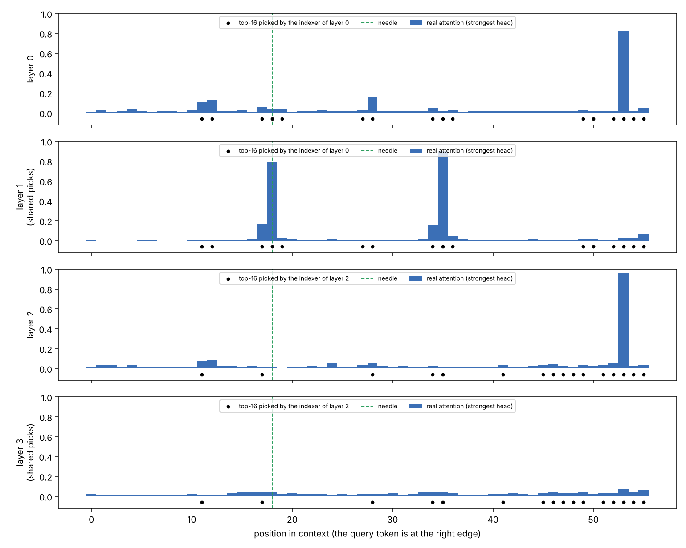

# nanoGLM: from "Let's build GPT" to a GLM-5.3-w8a8 style inference stack

A lecture in code. You have built makemore, and you have (or will have) watched
Karpathy's "Let's build GPT". That video ends with a ~10M parameter dense
transformer that samples Shakespeare slowly and in float32. A model like
GLM-5.3-w8a8 running in an inference engine differs from it in four ways that
matter:

1. **It remembers.** A KV cache, so each new token costs one token of work, not a whole re-read.
2. **It has experts.** Each token runs through 8 of 256 feed-forward networks, picked by a router.
3. **It skims.** Sparse attention: a cheap scorer picks 2,048 previous tokens, real attention reads only those.
4. **It is in int8.** Weights and activations are 8-bit integers (that is the `w8a8`), and so are the caches.

We build all four into one small model, train it on one GPU, and measure what
each one costs and buys. Then we point at the place in this repository
(`vllm-ascend`) where the production version of each piece lives.

```
data.py                 the task: needles in Shakespeare
nanoglm.py              the model: GPT + MoE + sparse attention + KV cache   (~400 lines)
train.py                two-stage training
quant.py                W8A8 from scratch                                    (~130 lines)
01_kv_cache.py          part 1
02_experts.py           part 2
03_sparse_attention.py  part 3
04_quantization.py      part 4
05_quant_sparse.py      part 5: quantizing the sparse attention itself
```

```bash
pip install torch matplotlib
```

```bash
python train.py --preset single_card
```

```bash
python 01_kv_cache.py
```

...and so on through `05`. No GPU? `--preset tiny` trains a 0.7M parameter
version on a CPU; every number printed in this document comes from that tiny
model (see [What was actually run](#what-was-actually-run)).

## What is GLM-5.3, concretely

According to its public model cards, GLM-5.3 has the same architecture as
GLM-5.2 (Hugging Face class `GlmMoeDsaForCausalLM`, model type `glm_moe_dsa`)
and differs in post-training. That architecture is what this repository
serves: see `docs/source/tutorials/models/GLM5.2.md`. GLM-5.3 itself is not
mentioned anywhere in this branch, so everything below about "GLM-5.x" is
checked against the GLM-5.2 code paths here, and the headline numbers come
from third-party model cards, not from a Z.ai paper.

| | GLM-5.3 (as reported) | nanoGLM `single_card` preset | nanoGLM `tiny` preset |
|---|---|---|---|
| parameters | ~750B total, ~40B used per token | 25M | 0.7M |
| layers | 78, the first 3 with a dense FFN | 6, the first 1 dense | 4, the first 1 dense |
| experts per MoE layer | 256, top-8, plus 1 shared | 8, top-2, plus 1 shared | 4, top-2, plus 1 shared |
| context | ~1M tokens | 512 chars | 128 chars |
| sparse attention | indexer picks 2,048 tokens per query | picks 48 | picks 16 |
| index sharing | some layers reuse an earlier layer's picks | every 2nd layer owns an indexer | same |
| deployed as | w8a8 (also w4a8, and "c8" caches) | we quantize it ourselves | same |

What we leave out, so you know it exists:

- **MLA** (multi-head latent attention). GLM-5.x does not cache K and V per
  head. It caches one small latent vector per token and expands it on use.
  You can see it in the names `q_a_proj` and `kv_a_proj_with_mqa` in
  `vllm_ascend/quantization/modelslim_config.py:126`, and in
  `class AscendSFAImpl(MLAAttentionImpl)`. We use plain multi-head attention.
- **MTP** (a small extra layer that drafts the next few tokens for speculative decoding).
- Batching many users, paged cache memory, graph compilation, multi-card
  parallelism. Parts 1 and 6 say where to look.

## The task: needles in Shakespeare

Tiny Shakespeare is a bad test for sparse attention: to guess the next
character you need the last few words, never something 400 characters back.
So we splice small records into the prose (`data.py`):

```
e Rivers talk'd how I did grow
More t[g=21]han my brother: 'Ay,' quoth my uncle
Glouc[g?21]ester,
'Small herbs have grace, great weeds d[g?21]o grow ap
```

`[g=21]` SETs key `g` to 21. `[g?21]` is a QUERY: after `[g?` the model must
produce the value that was set, possibly hundreds of characters earlier.

- Prose needs local context. Every model gets this.
- The two digits of a QUERY need exactly one distant place, the **needle**.
  Chance is 10% per digit. This is our sharp metric: **query accuracy**.

The data loader returns, next to the usual `x, y`, a mask of the query-digit
positions and the position of each needle. So we can ask not only "did the
model get it right" but "did the sparse attention keep the needle in view".

## Part 0: from Karpathy's GPT to a 2025-style block

Open `nanoglm.py`. Compared to the model from the video:

| "Let's build GPT" | here | why |
|---|---|---|
| learned position embedding added to the input | **RoPE**: rotate q and k inside attention | a key is rotated once, by its own absolute position, and is then valid forever. That is what makes it cacheable. |
| LayerNorm | **RMSNorm** | same job, no mean subtraction, no bias |
| `Linear, ReLU, Linear` | **SwiGLU**: `down(silu(gate(x)) * up(x))` | what every current LLM uses; `gate` and `up` are one fused matrix |
| dropout | none | |
| `tril` buffer | a `causal` mask built from positions | it has to work when the keys come from a cache |

Nothing here changes what the model can do. It is the same GPT.

## Part 1: the KV cache

`generate` in the video feeds the entire sequence back in for every new
character. But token 500's key and value vectors in layer 3 depend only on
tokens 0..500. They never change. So keep them:

```python
# Attention.forward
if cache is not None:
    if "k" in cache:
        k, v = torch.cat((cache["k"], k), dim=2), torch.cat((cache["v"], v), dim=2)
    cache["k"], cache["v"] = k, v
```

and `generate` becomes two phases that every inference engine has:

- **prefill**: the whole prompt goes through at once (T tokens, T queries);
- **decode**: one new token at a time (1 query against S cached keys).

First rule of inference engineering: an optimization is a claim that two
programs compute the same thing. Check it.

```
max |logits(full forward) - logits(prefill + cached decode)|
  sparse=False  : 7.63e-06
  sparse=mask   : 6.90e-06
  sparse=gather : 7.93e-06
```

```
cache of layer 0 after 128 tokens:
  k   (1, 4, 128, 24)      48 KiB
  v   (1, 4, 128, 24)      48 KiB
  ik  (1, 128, 32)         16 KiB
  ('ik' = lightning indexer keys: a second, much smaller cache next to K and V)
no cache, dense         :   181.0 tokens/s
cache, dense            :   446.0 tokens/s
cache, sparse (gather)  :   360.9 tokens/s
```

(Single CPU thread, tiny model. The dense/sparse comparison on a context this
short says nothing; see the count below.)

In a real engine the cache is not one growing tensor per request. vLLM cuts
cache memory into fixed blocks (128 tokens each for this backend, see
`get_supported_kernel_block_sizes` in `vllm_ascend/attention/sfa_v1.py`) and
gives every request a `block_table`: a list of block numbers. Appending never
copies, and a finished request returns its blocks to the pool. The attention
kernels take the block table as an input and do the lookup themselves.

## Part 2: experts (MoE)

The FFN is where most parameters of a transformer live. MoE's bet: make the
FFN enormous, but let each token use only a small part of it.

```python
# MoE.forward, step 1: route
scores = torch.sigmoid(self.router(x))  # [N, E] one score per expert
topv, topi = scores.topk(self.top_k, dim=-1)  # each token keeps its best K
gates = topv / topv.sum(-1, keepdim=True)  # mixing weights
```

The output is `shared(x) + sum of gate * expert(x)` over the K chosen experts.
The router is one small matrix. That is all there is to "routing".

During training one more loss keeps the router from sending everything to two
favourite experts (`balance_loss`: it is smallest when all experts get the same
share).

**What did they learn?** `02_experts.py` labels each character by its role and
counts where the router sends it:

```
layer 0: dense FFN (no routing)

layer 1: share of expert picks (%), rows sum to 100
                      e0  e1  e2  e3
prose letter          24  26  24  26
prose space/punct     23  19  22  36
record bracket [ ]    10  34  37  19
record key letter     45  30   8  18
record = or ?         23  39  31   7
record digit          20  17  30  33
ALL TOKENS (load)     23  25  25  26

layer 2: share of expert picks (%), rows sum to 100
                      e0  e1  e2  e3
prose letter          23  28  19  29
prose space/punct     14  28  26  32
record bracket [ ]    22  13  28  37
record key letter     26  15  45  14
record = or ?         50  18  23   8
record digit          50  20  25   5
ALL TOKENS (load)     25  25  23  26

layer 3: share of expert picks (%), rows sum to 100
                      e0  e1  e2  e3
prose letter          23  22  32  23
prose space/punct     22   3  34  42
record bracket [ ]    10  35  16  39
record key letter     20  18  28  34
record = or ?         34  50  15   1
record digit          40  43   8   9
ALL TOKENS (load)     23  23  28  26
```

Each row is one kind of character, each column an expert. Prose letters are
spread evenly. Record characters are not: in layer 3, `=`/`?` and digits go to
experts 0 and 1 and almost never to expert 3, while prose punctuation almost
never goes to expert 1. Nobody told the router what a record is. The last row
is the load balancing loss at work: overall, every expert gets about a quarter.

**How does an engine run this?** The naive way runs all E experts on all
tokens and multiplies most results by zero. The real way: sort the
(token, expert) pairs by expert, so that every expert gets one contiguous slab
of rows, and run one matmul per slab.

```python
# MoE.forward, steps 2 and 3
order = topi.flatten().argsort(stable=True)
...
for e, n in enumerate(counts.tolist()):
    rows = token_id[start : start + n]
    y = self.experts[e](x[rows]) * gate[start : start + n, None]
    out = out.index_add(0, rows, y)
```

That loop, done in one kernel, is called **grouped matmul** (GMM). In this
repo: routing is `select_experts` in
`vllm_ascend/ops/fused_moe/experts_selector.py`, and the int8 expert kernel is
`npu_grouped_matmul_swiglu_quant` (`csrc/gmm/`, used from
`vllm_ascend/quantization/methods/w8a8_dynamic.py`): group, matmul, SwiGLU
and re-quantize in one call.

```
naive (all experts on all tokens): 0.012s | grouped (sort tokens by expert): 0.011s | max diff 3.0e-08
naive costs E=4 expert passes per token, grouped costs K=2. For GLM-5.x that is 256 vs 8.
MoE layer parameters: 139K total, 83K touched per token (all of them must sit in memory, few of them cost compute)
```

The asymmetry to remember: **all** expert weights must be in memory, **few**
are computed with. MoE inference is limited by memory and by moving tokens to
where the expert weights are, not by arithmetic. With E=4 and K=2 our grouped
version is no faster than the naive one: it does half the arithmetic and pays
it back in bookkeeping. With E=256 and K=8 the naive one is not an option.

Notice `counts.tolist()`. It forces the device to stop and hand a number to
Python. `AGENTS.md` in this repo has a rule against exactly that (`.item()`
in hot paths), and it is one reason the real thing is a single kernel.

## Part 3: sparse attention

### The problem

For every new token, dense attention computes a dot product with **every**
cached key, in every head, in every layer. At a 1M token context that
dominates everything else, and nearly all of that attention weight is ~0.

### The idea (DSA: DeepSeek Sparse Attention, used by GLM-5.x)

Split attention into two jobs:

1. **Find**: a tiny scorer, the *lightning indexer*, gives every previous
   token a relevance score. Keep the top-k.
2. **Read**: ordinary attention, but only over those k tokens.

```python
class LightningIndexer:
    # I[t, s] = sum over heads h of   w[t, h] * relu( q[t, h] . k[s] )
    def score(self, q, k, w):
        s = torch.einsum("bthd,bsd->bths", q, k)
        return torch.einsum("bths,bth->bts", F.relu(s), w)
```

Compare with real attention: few heads, small vectors, **one** key per token
shared by all heads, no softmax, no value vectors. It only has to rank.

Then, in `Attention.forward`:

```python
topk = stable_topk(scores, min(top_k, S))
...
k_sel = k[b, :, idx]  # gather: [B, H, T, k, hd]  only k keys, however long the context
v_sel = v[b, :, idx]
att = softmax(q.k_sel)
y = att @ v_sel
```

### How do you train something that contains a top-k?

Top-k has no gradient: nothing tells the indexer "you should have picked
token 37". The trick is to not send gradients through the selection at all.
The indexer is trained by **imitation**:

```python
def index_loss(scores, allowed, attention_maps):
    target = torch.stack(attention_maps).mean(0)  # where attention really went
    logp = scores.masked_fill(~allowed, -inf).log_softmax(-1)
    return -(target * logp).sum(-1).mean()  # cross entropy
```

and it sees `x.detach()`, so the model is never bent to make the indexer's
life easier. Training has two stages (`train.py`), following the recipe
published for DeepSeek-V3.2:

1. **dense warm-up**: the model trains with normal dense attention. The
   indexers watch and learn to predict where attention goes.
2. **sparse stage**: attention is restricted to the indexer's top-k. The model
   adapts to seeing only that; the indexer keeps imitating, now inside the
   selected set.

Watch the two columns `dense` and `sparse` in the training log. They are the
same weights, evaluated with all 128 tokens visible and with only the top 16
visible:

```
step     0 | val loss dense 4.372 sparse 4.371 | query acc dense 0.002 sparse 0.007 | 1s
step   250 | val loss dense 2.098 sparse 2.340 | query acc dense 0.093 sparse 0.083 | 48s
step   500 | val loss dense 1.916 sparse 1.976 | query acc dense 0.130 sparse 0.137 | 92s
step   750 | val loss dense 1.766 sparse 1.821 | query acc dense 0.748 sparse 0.704 | 136s
step  1000 | val loss dense 1.708 sparse 1.752 | query acc dense 0.797 sparse 0.748 | 178s
step  2000 | val loss dense 1.570 sparse 1.600 | query acc dense 0.813 sparse 0.796 | 348s
--- step 3000: switching to sparse attention (top-16 of 128) ---
step  3000 | val loss dense 1.531 sparse 1.553 | query acc dense 0.817 sparse 0.825 | 522s
step  3250 | val loss dense 1.532 sparse 1.531 | query acc dense 0.816 sparse 0.821 | 570s
step  4000 | val loss dense 1.522 sparse 1.516 | query acc dense 0.810 sparse 0.826 | 708s
```

Around step 750 the model discovers the lookup and query accuracy jumps from
chance. The sparse column follows right behind: the indexers learn where to
look almost as fast as the model learns to look there. Until step 3000 the
sparse loss stays a little worse than the dense one. After the switch the order
flips: it is now a sparse model, and showing it all 128 tokens is the
unfamiliar setting. (Query accuracy is measured on about 1,400 digits, so
differences of a point or so are noise.)

### Training with a mask, serving with a gather

During training we compute the full T x S attention and mask out everything
that was not selected (`sparse="mask"`). Wasteful, but the full attention
matrix is what the indexer loss needs. At inference we gather
(`sparse="gather"`). `01_kv_cache.py` checks that both give the same logits,
with and without a cache.

That check failed the first time this code ran, by 0.2 in the logits, and the
reason is instructive. `relu` makes many indexer scores exactly 0.0, so
ties at the k-th place are common, and `torch.topk` breaks ties differently
for a [T, S] prefill than for a [1, S] decode step. Same model, same tokens,
different picks. The fix is `stable_topk` (ties go to the earlier token). A
selection step turns "equal up to 1e-7" into "different": top-k is a
discontinuous function. Remember this for part 5.

### Index sharing

Top-k picks from layer 4 and layer 5 are mostly the same tokens. So GLM-5.2
and 5.3 give only some layers an indexer; the others reuse the previous
selection. In `nanoglm.py` that is `indexer_layers=(0, 2, 4)` and the `topk`
value handed from block to block. In this repo it is `skip_topk` and
`topk_indices_buffer` in `sfa_v1.py`, and the comment at
`vllm_ascend/patch/__init__.py:740`: "GLM-5.2 checkpoints omit `Indexer`
weights on shared-indexer layers".

One consequence took a failed run to notice. If the layer-0 indexer imitates
only layer 0's attention, it selects what layer 0 wants, and layer 1 (which
reuses the selection, and is where this model does its lookup, see below) goes
blind: in an earlier version of this code query accuracy was 69% sparse
against 81% dense. Training each indexer on the average attention of **all
layers it serves** closed the gap. How Z.ai trains
shared indexers is not something this repo can tell us; this is our choice.

### Does it find the needle?

```
dense attention (all 128 tokens): loss 1.522  query acc 0.810

   k |    lightning indexer     |      last k tokens       |     random k tokens     
     |       loss     query acc |       loss     query acc |       loss     query acc
   4 |      1.898         0.562 |      2.355         0.072 |      4.667         0.010
   8 |      1.581         0.750 |      2.138         0.090 |      4.327         0.029
  16 |      1.516         0.826 |      1.897         0.228 |      3.851         0.081   <- trained with this k
  32 |      1.516         0.813 |      1.692         0.558 |      3.111         0.281
  64 |      1.519         0.815 |      1.570         0.757 |      2.168         0.607
 128 |      1.522         0.810 |      1.522         0.810 |      1.522         0.810
```

Read the table by rows. Same model, same budget of k tokens, three ways to
spend it. With 16 of 128 tokens the indexer matches dense attention (82.6%
against 81.0%, within noise). The 16 most recent tokens give 22.8%, 16 random
ones 8.1%. And look at k=8: half the budget it was trained with, still 75%.

```
needle recall at query digits (per layer that owns an indexer):
  k=  4: layer 0: 0.507  layer 2: 0.228
  k=  8: layer 0: 0.801  layer 2: 0.429
  k= 16: layer 0: 0.994  layer 2: 0.589
  k= 32: layer 0: 0.997  layer 2: 0.759
  k= 64: layer 0: 1.000  layer 2: 0.949
```

```
one query: ...'rs and fri[r?' must be followed by '1'
the needle is 37 tokens back: '[r=16]'
 where does the model itself look? strongest head's attention on the needle, per layer:
   layer 0: 0.04  layer 1: 0.79  layer 2: 0.01  layer 3: 0.04
 indexer of layer 0: needle is rank 4 of 56 | its top-8 are ['[', '8', '0', '1', '6', '=', '\n', '='] at distances [2, 20, 19, 37, 36, 38, 27, 21]
 indexer of layer 2: needle is rank 18 of 56 | its top-8 are ['[', '?', '=', 'n', '8', '\n', 'i', ' '] at distances [2, 0, 38, 8, 20, 27, 3, 6]
```

The lookup happens in **layer 1**: one head puts 0.79 of its attention on the
needle. Layer 1 has no indexer. It reads through the 16 tokens that the
indexer of layer 0 picked, and that indexer keeps the needle 99.4% of the
time. How? It cannot match keys: at layer 0 a token is only its embedding and
its position, it knows nothing about its neighbours. Look at its top-8: `[`,
`=` and digits. It learned *what kind of token is worth keeping* (anything
inside a record) and leaves the matching to the attention. The indexer of
layer 2 serves layers that have other things to do, and keeps the needle less
often.

`03_sparse_attention.py` draws this (the same query as above):



### What it costs

```
work per decoded token, for 2 attention layer(s) sharing one indexer (multiply-adds):
 context S   dense attn    indexer  sparse attn  DSA total  saving
nanoGLM
       128     2.46e+04   8.19e+03     3.07e+03   1.13e+04    2.2x
      1024     1.97e+05   6.55e+04     3.07e+03   6.86e+04    2.9x
      8192     1.57e+06   5.24e+05     3.07e+03   5.27e+05    3.0x
     65536     1.26e+07   4.19e+06     3.07e+03   4.20e+06    3.0x
a GLM-5.x sized layer (64 heads x 256, indexer 32 x 128, top-2048)
      2048     6.71e+07   8.39e+06     6.71e+07   7.55e+07    0.9x
     16384     5.37e+08   6.71e+07     6.71e+07   1.34e+08    4.0x
    131072     4.29e+09   5.37e+08     6.71e+07   6.04e+08    7.1x
   1048576     3.44e+10   4.29e+09     6.71e+07   4.36e+09    7.9x
The indexer still looks at every token: DSA is O(S) per token with a small constant, not O(k).
(the GLM-5.x head sizes above are illustrative: read the real ones from the model's config.json)
```

Two honest observations. First, DSA is **not** O(k): the indexer still visits
every previous token. It replaces a large per-token cost by a small one, and
the saving only shows when the context is much longer than k. Our toy runs at
context 128 with k=16, deep in the regime where it does not pay. Second, since
the indexer is now the part that scales with context, **the indexer's cache is
the thing you most want to make small and cheap**. That is part 5.

## Part 4: W8A8

A float32 weight is 4 bytes, a bfloat16 weight is 2. ~750B parameters in
bf16 is ~1.5 TB; `docs/source/tutorials/models/GLM5.2.md` asks for two 8-card
A3 nodes for the bf16 model and one for `GLM-5.2-w8a8`. Quantization is what
decides how many machines you need.

### The whole idea in three lines

```python
scale = x.abs().max() / 127
x_q   = round(x / scale)          # an int8 in [-127, 127]
x     ~ x_q * scale
```

A matmul of two such things:

```
y = x @ W.T  ~  (x_q @ W_q.T) * (scale_x * scale_w)
                 ^ integers only     ^ one float multiply at the end
```

### Who shares a scale?

This is the only design decision, and the names in `w8a8` schemes are answers to it.

- **Weights, per channel**: one scale per output row of W, computed offline.
  Free at runtime: `scale_w` is just a vector multiplied on the output.
- **Activations, dynamic, per token**: measure each token's max at runtime
  and give each token its own scale. `dynamic_quant` in `quant.py`, and
  `torch_npu.npu_dynamic_quant` at
  `vllm_ascend/quantization/methods/w8a8_dynamic.py:81`, followed by
  `npu_quant_matmul`. Costs a max and a divide per token.
- **Activations, static, per layer**: one scale fixed ahead of time from
  calibration data. No runtime cost, but one scale must cover the largest
  activation any token will ever have. `w8a8_static.py`: `input_scale`,
  `input_offset`, and `deq_scale = input_scale * weight_scale`, exactly the
  product in the formula above.

Why can activations not get a per-channel scale like weights do? Because in
`sum_i x_i * W_ji` the scale of x would then sit inside the sum, different for
each i, and the integer matmul would no longer be an integer matmul. A
per-token scale factors out of the sum. A per-channel one does not.

### One layer by hand

```
one row of W, float : ['+0.1383', '+0.0077', '-0.1669', '+0.0519', '-0.0706', '-0.0149']
the same row, int8  : [93, 5, -112, 35, -47, -10] x scale 0.001494
int32 accumulator: max |value| = 211556 (int32 holds 2147483647), float emulation identical: True
relative error of the layer output: W8A16 0.0022 | W8A8 dynamic 0.0039
max|x| per token at this layer: median 4.24, largest 6.16 (1.5x). One static scale must cover the largest, so the median token only uses ~88 of 127 levels.
```

### The whole model, no retraining

```
                                dense attention  | sparse attention  |
                                   loss   q. acc |     loss   q. acc |      size
float32                          1.5223    0.810 |   1.5158    0.826 |   2.86 MB
W8A16 (weights only)             1.5223    0.807 |   1.5156    0.828 |   0.79 MB
W8A8 dynamic (per token)         1.5226    0.814 |   1.5159    0.826 |   0.79 MB
W8A8 static (per layer)          1.5285    0.812 |   1.5217    0.818 |   0.79 MB
W6A8 dynamic                     1.5249    0.813 |   1.5178    0.824 |   0.79 MB
W8A6 dynamic                     1.5269    0.807 |   1.5203    0.823 |   0.79 MB
W4A8 dynamic                     1.5488    0.806 |   1.5411    0.820 |   0.79 MB
W8A4 dynamic                     1.6001    0.813 |   1.5928    0.809 |   0.79 MB
(size counts every int8 weight as 1 byte, so it is the size you would ship; W4 would pack to half of W8)
```

8 bits is nearly free: the loss moves in the fourth decimal with per-token
scales, and by 0.006 with one static scale per layer. That is the real-world
finding too, and the reason w8a8 is a default deployment format and not a
research topic. Things start to move below 8 bits, and there activations hurt
more than weights (W8A4 is worse than W4A8).

### What is fragile?

Quantize one group of layers brutally (4-bit weights and activations), leave
the rest in float:

```
sensitivity: only one group at W4A4 dynamic, sparse attention (float: loss 1.5158, acc 0.826)
group                         #weights     loss   d loss  q. acc
attn.qkv                        110592   1.5357  +0.0199   0.811
attn.proj                        36864   1.5282  +0.0124   0.816
indexer (wq, wk_weights)         18816   1.5182  +0.0023   0.813
MoE router                        1152   1.5172  +0.0014   0.829
MoE experts                     331776   1.5436  +0.0278   0.830
MoE shared expert                82944   1.5291  +0.0133   0.822
dense FFN (layer 0)             110592   1.5222  +0.0064   0.830
lm_head                           7392   1.5270  +0.0112   0.828
(700128 weights in Linear layers in total; the embedding table is left in float)
```

In total damage the big groups win, simply because they are big: the experts
hold 47% of the weights and cause the largest loss increase. Divide by the
number of weights and the order flips. Per weight, `lm_head` and the router
are the most fragile, about 15x more than an expert weight. Both are small
matrices whose output is a *decision* (which character, which expert). The
practical rule that follows: keeping a few small decision layers in higher
precision costs almost no memory. The description file that msmodelslim
writes lists a quantization type per layer for exactly this reason.

## Part 5: quantizing the sparse attention

Per decoded token, per indexer, the engine reads one indexer key for **every**
token in the context. At 1M tokens that is a lot of memory traffic. So the
production path stores indexer keys as int8, and the K/V cache too. In this
repo that is "C8" (`enable_sparse_c8`), with kernels
`csrc/attention/lightning_indexer_quant` and
`csrc/attention/kv_quant_sparse_flash_attention`.

For the indexer the right question is not "how accurate is the score". It is
"**does the top-k set stay the same**".

```
indexer q, k                           same picks  needle recall     loss  q. acc
float                                       1.000          0.792   1.5158   0.826
int8                                        0.994          0.795   1.5158   0.823
int8 + Hadamard                             0.995          0.789   1.5159   0.825
int6                                        0.979          0.795   1.5151   0.826
int6 + Hadamard                             0.981          0.783   1.5159   0.824
int4                                        0.923          0.775   1.5211   0.810
int4 + Hadamard                             0.929          0.780   1.5204   0.814
int3                                        0.835          0.691   1.5651   0.727
int3 + Hadamard                             0.846          0.682   1.5639   0.732
float, outlier channels x100                1.000          0.792   1.5158   0.826
int8, outlier channels x100                 0.878          0.780   1.5351   0.812
int8 + Hadamard, outlier channels x100      0.935          0.792   1.5161   0.824
```

### The Hadamard trick

First the plain rows. int8 keeps 99.4% of the picks, 4 bits still 92%, and at
3 bits the selection falls apart and takes query accuracy with it. On this
model the Hadamard rows are the same as the plain ones, within noise.

Now the last three rows. "Outlier channels" means: multiply two channels of
every key by 100 and divide the same two channels of every query by 100. `q . k` is unchanged, the float row proves it is the *same model*.
But a per-token int8 scale is set by the largest entry, so in the keys every
other channel is squeezed into a few integer levels, and in the queries the
two shrunken channels round to zero. Two float-identical models, one of which
quantizes badly: 12% of the picks change and the loss goes from 1.516 to 1.535.

Real networks grow such channels on their own. The fix is to rotate before
quantizing:

```python
q, k = q @ H, k @ H  # H orthonormal:  (qH).(kH) = q.k
```

A Hadamard matrix is all +-1/sqrt(n), so every output channel is an equal
mix of all input channels: the outlier is smeared evenly, and int8 has an
easy vector to represent. It costs nothing in accuracy in float, and one
small matmul. In the table it brings the loss back to 1.516.

This is not a toy invention. `vllm_ascend/attention/sfa_v1.py`:

```python
# line 728
AscendSFAImpl.q_hadamard = torch.tensor(scipy.linalg.hadamard(128), ...) / ...
# indexer_select_pre_process (keys, on their way into the cache)
k_li = k_li @ AscendSFAImpl.k_hadamard
k_li, k_li_scale = torch_npu.npu_dynamic_quant(k_li.view(-1, self.head_dim), dst_type=self.c8_k_cache_dtype)
# indexer_select_post_process (queries)
q_li = q_li @ AscendSFAImpl.q_hadamard
q_li, q_li_scale = torch_npu.npu_dynamic_quant(...)
```

Rotate, per-token dynamic quantize to int8, keep the scale next to the key in
the cache. `make_transform(8, rotate=True)` in `05_quant_sparse.py` is those
four lines. (128 is the indexer head dimension there; ours is 32, which is why
`index_head_dim` has to be a power of two.)

### The K/V cache, and everything together

```
B. quantizing the K/V cache of the real attention (one scale per token per head)

K, V in cache                              loss  q. acc
float                                    1.5158   0.826
int8                                     1.5159   0.826
int6                                     1.5165   0.826
int4                                     1.5254   0.822

C. everything at once: the 'w8a8c8' deployment

configuration                                                    loss  q. acc
float, dense attention                                         1.5223   0.810
float, sparse attention                                        1.5158   0.826
W8A8 linears, sparse attention                                 1.5159   0.826
W8A8 linears + int8 indexer (Hadamard) + int8 K/V cache        1.5160   0.822
```

## Part 6: the map

| nanoGLM | vllm-ascend (this branch) |
|---|---|
| `NanoGLM`, `Block` | the model class is upstream vLLM (`GlmMoeDsaForCausalLM` in `vllm/model_executor/models/deepseek_v2.py`); this repo patches it, see `vllm_ascend/patch/__init__.py` |
| `MoE.forward` routing | `vllm_ascend/ops/fused_moe/experts_selector.py` (`select_experts`) |
| `MoE.forward` grouped expert loop | `vllm_ascend/ops/fused_moe/`, kernels in `csrc/gmm/` |
| `Attention.forward` with `sparse="gather"` | `vllm_ascend/attention/sfa_v1.py` (`AscendSFAImpl.forward`), kernel `csrc/attention/sparse_flash_attention` |
| `LightningIndexer.project` (keys into the cache) | `indexer_select_pre_process` in `sfa_v1.py` |
| `LightningIndexer.score` + top-k | `indexer_select_post_process` in `sfa_v1.py`, kernel `csrc/attention/lightning_indexer` |
| `topk` passed between blocks | `skip_topk`, `topk_indices_buffer` in `sfa_v1.py` |
| `cache["k"]`, `cache["v"]`, `cache["ik"]` | paged KV cache with `block_table`; the indexer cache is a separate layer, `vllm_ascend/attention/indexer.py` |
| `QLinear(act="dynamic")` | `vllm_ascend/quantization/methods/w8a8_dynamic.py` |
| `QLinear(act="static")` | `vllm_ascend/quantization/methods/w8a8_static.py` |
| `quantize_model` (done offline) | msmodelslim produces the weights; `vllm_ascend/quantization/modelslim_config.py` reads its description file |
| `make_transform(8, rotate=True)` | `q_hadamard`, `k_hadamard` in `sfa_v1.py`, kernel `csrc/attention/lightning_indexer_quant` |
| `kv_transform = fake_quant` | `vllm_ascend/quantization/methods/kv_c8.py`, kernel `csrc/attention/kv_quant_sparse_flash_attention` |

A good next step is to read `AscendSFAImpl.forward` in `sfa_v1.py` from top
to bottom. It is about 260 lines, and after this lecture you should recognise each
stage: project, write keys to the cache, indexer scores, top-k (or reuse),
sparse attention, output projection.

## What was actually run

Everything in this directory was executed, on a 4-core CPU with no GPU, with
`--preset tiny` (0.7M parameters, context 128, 4,000 steps, about 12 minutes).
All numbers above are from that run.

`--preset single_card` (25M parameters, context 512, batch 64, 12,000 steps)
has **not** been run: the machine this was written on had no accelerator of
any kind. The code path is the same, plus bf16 autocast. Treat its settings as
a first guess, on the order of an hour.

Its memory I did measure, by running training steps on CPU: **about 0.27 GB
per unit of batch size**, so batch 64 needs roughly 17 GB. That fits an Atlas
A2 (64 GB) or A3 (128 GB) card with room to spare. It is dominated by the
full attention matrices, which the indexer loss forces us to keep for the
backward pass; halve the batch if you are tighter than that.

## Running it on an Ascend NPU

This is a plain PyTorch model, so it does not need vLLM, CANN custom kernels
or anything else from the surrounding repository. It needs `torch` and
`torch_npu`. `pick_device()` in `nanoglm.py` selects `npu` when `torch_npu`
imports and a device is visible, else `cuda`, else `cpu`, and training uses
bf16 autocast on whichever it finds.

**Untested.** No Ascend device was available where this was written, so the
NPU path is reasoned, not run. Two things to check first:

- **`stable_topk`** (`nanoglm.py`) relies on `torch.sort(..., stable=True)`.
  If a backend quietly ignores `stable`, prefill and decode can pick different
  tokens on a tie and the equivalence check in `01_kv_cache.py` fails. Run
  that script first: it is the canary, and it is exactly the bug described in
  part 3.
- **The int32 matmul** in `04_quantization.py` is pinned to CPU on purpose. A
  generic `int32 @ int32` is a CPU-only operation in PyTorch; accelerators
  reach int8 matmul through a dedicated kernel instead, which on Ascend is
  `torch_npu.npu_quant_matmul`. That one line demonstrates the semantics, not
  the hardware path.

The rest is ordinary dense arithmetic (`einsum`, `sort`, `index_add`,
`bincount`, `multinomial`). The MoE loop's `counts.tolist()` forces a device
sync per layer per step, which `AGENTS.md` warns about for exactly this
reason; it is slow on an accelerator but correct, and the comment in part 2
exists to make that visible.

If you want the real Ascend kernels rather than this teaching version, the
model to deploy is GLM-5.2 or GLM-5.3-Flash through vLLM-Ascend proper; see
`docs/source/tutorials/models/`.

One thing to look for. The tiny model's query accuracy stops near 81%.
Breaking the errors down shows why:

```
query accuracy, sparse attention:
  first digit 0.690 | second digit 0.966
  first digit, by number of other SETs between the needle and the query:
    0 : 0.811  (n=470)
    1 : 0.482  (n=197)
    2 : 0.491  (n=53)
    3+: 0.389  (n=18)
```

It is very good at the second digit (once it has the first, it knows where it
is copying from) and it is good when nothing stands between needle and query.
It has only partly learned to *match the key*; much of its skill is "copy from
the most recent record". Whether the larger preset learns the full lookup is
the first thing to check when you run it, and exercise 1.

## Exercises

1. **Look at your errors.** Reproduce the breakdown above for your trained
   model (accuracy by number of SETs between needle and query). If it is not
   flat, your model is not really doing key lookup. Does more training fix it?
   A wider model? A larger weight on the query digits in the loss?
2. **k.** Train with `index_topk` 8, 16, 64. Where does query accuracy break?
   Is it the indexer (needle recall) or the model?
3. **No sparse stage.** Train with `--sparse_frac 0`. How big is the gap
   between the dense and sparse columns at the end, compared to the default?
4. **Index sharing.** Train with `indexer_layers=(0,)`, then with every layer
   owning an indexer. Count indexer parameters and compare needle recall.
5. **Indexer target.** In `index_loss`, change the target back to the owner
   layer's attention only (`attention_maps[:1]`). How far does sparse query
   accuracy fall behind dense?
6. **Static quantization done properly.** `calibrate` records the max. Use a
   99.9th percentile instead and clip. Add an offset (asymmetric range), as
   `input_offset` in `w8a8_static.py` does. Which layers benefit?
7. **Rotate the residual stream.** Part 5 rotated the indexer's q and k. Do
   the same for a `QLinear`: `W' = W @ H.T`, `x' = x @ H.T`. Does W4A4 improve?
   (This is the idea behind QuaRot-style methods.)
8. **MLA.** Replace `cache["k"]`, `cache["v"]` by a single latent
   `c = W_a x` of dimension 32 per token, and compute `k = W_k c`, `v = W_v c`
   after the gather. How much smaller is the cache? What happens to RoPE?
9. **Real kernel shapes.** Read `csrc/attention/sparse_attn_sharedkv/README.md`
   and map each input (`q`, `ori_kv`, `cmp_sparse_indices`, `ori_block_table`,
   `cu_seqlens_q`) to a tensor in `Attention.forward`.

## Sources

- GLM-5.3 architecture figures: [NVIDIA NIM model card](https://docs.api.nvidia.com/nim/reference/z-ai-glm-5-3), [build.nvidia.com](https://build.nvidia.com/z-ai/glm-5-3.md), [NeMo AutoModel GLM-5 page](https://docs.nvidia.com/nemo/automodel/model-coverage/large-language-models/thudm/GLM-5). Third-party pages; they disagree slightly on the total parameter count.
- DSA and its two-stage training: the DeepSeek-V3.2 technical report.
- Everything about the serving path: the files in this repository named above.
